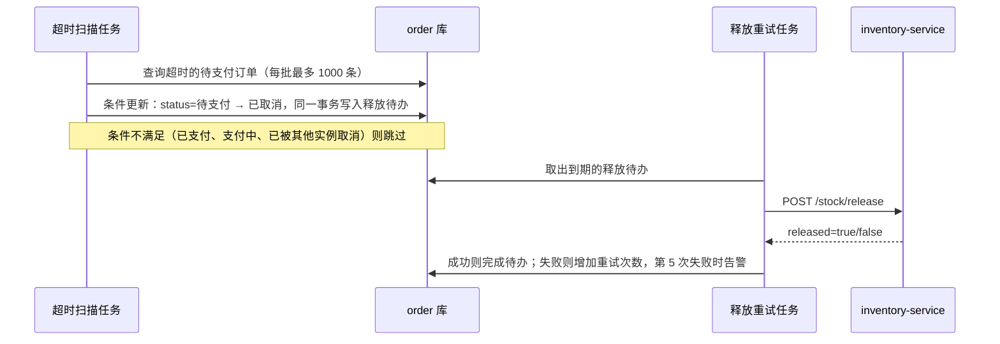

# REQ-0000 设计

## 服务影响矩阵

| 服务 | 目标分支 | 改动概述 | 接口变化 | 数据变化 |
|---|---|---|---|---|
| order-service | develop-v6.11.1 | 新增超时扫描任务；取消后登记库存释放待办，由后台重试调用库存服务 | 无对外接口变化；新增对库存释放接口的调用 | `t_order` 加索引；新建 `t_stock_release_todo` |
| inventory-service | develop-v6.11.1 | 新增库存释放接口，按订单号保证幂等 | 新增 `POST /stock/release` | `t_stock_lock` 加 `released_at` 字段 |

## 接口变更

### inventory-service：POST /stock/release

- 类型：新增
- 调用方：order-service
- 关键字段：请求带 `orderNo`（必填）和 `reason`；响应带 `released`，重复请求时返回 `false`，HTTP 状态仍为 200
- 兼容性：新增接口，对现有调用方没有影响

字段明细在实现后同步到接口文档平台。

## 数据变更

- order-service：
  - `t_order` 增加 `(status, create_time)` 联合索引，供扫描使用。使用在线 DDL，不锁表。
  - 新建 `t_stock_release_todo`：订单号（唯一）、重试次数、下次重试时间、状态。
- inventory-service：`t_stock_lock` 增加可空字段 `released_at`，用来判断是否已经释放过。
- 回滚时保留这些字段和表，不需要删除。

## 关键流程

## 关键决策

- **多实例互斥用条件更新**：`UPDATE ... WHERE status = '待支付'`，影响行数为 0 就说明已被其他实例处理或状态已变化。不引入分布式锁，因为条件更新已经能保证只取消一次。
- **释放失败用本地待办表重试，不用 MQ**：取消订单和写入待办在同一个本地事务里，保证"订单取消了，就一定会尝试释放库存"。目前订单和库存之间没有 MQ，为这一个需求引入 MQ 超出了范围。如果以后两个服务之间引入 MQ，可以再讨论迁移，届时记录 ADR。

## 上线顺序与回滚

1. 发布 inventory-service。新接口向后兼容，可以先上线。
2. 发布 order-service，扫描开关默认关闭。
3. 观察一天后打开扫描开关。首次打开时会处理积压的历史超时订单，单批 1000 条的上限可以控制压力。

回滚方案：关闭扫描开关即可停止取消。已经取消的订单不恢复（已与业务方确认）。

## 风险

- 首次打开开关时积压订单较多，库存服务的调用量会短时升高。缓解：单批上限，加上重试任务的退避间隔。
- 超时时长配置被误改得很短，可能误取消正常订单。缓解：配置校验下限为 5 分钟。
